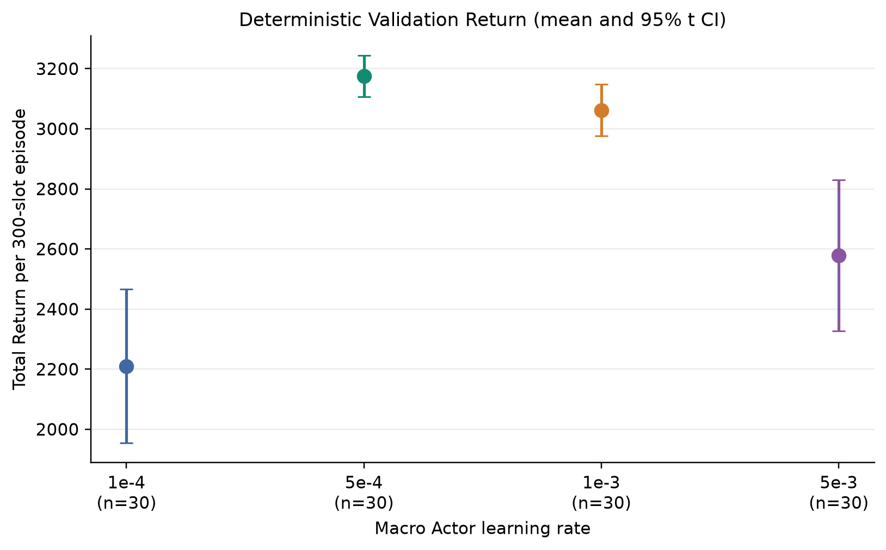
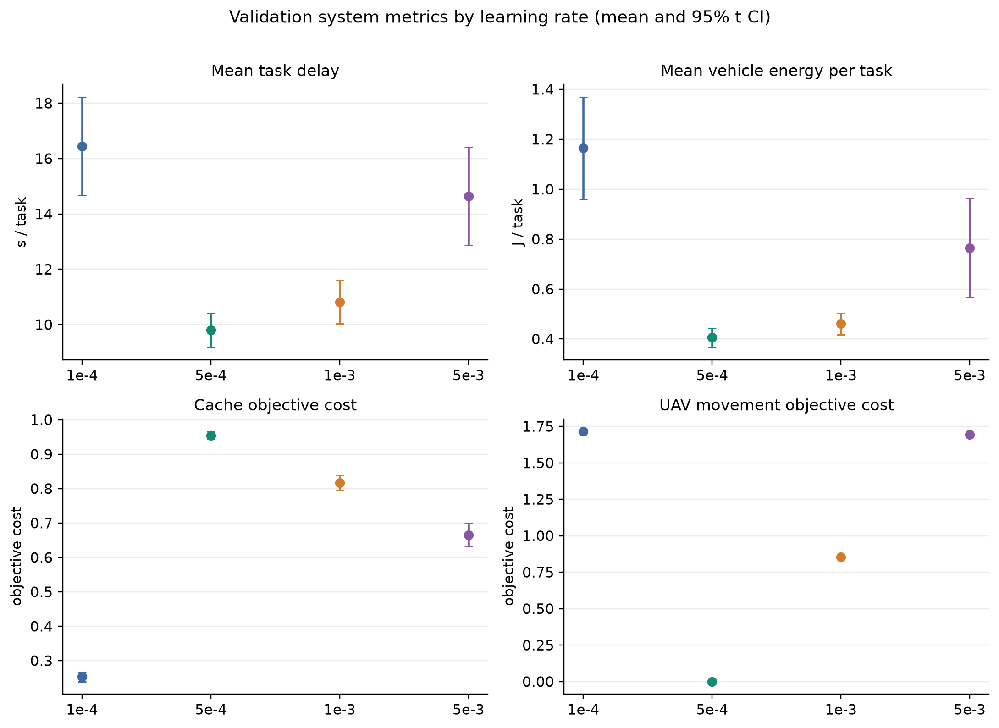
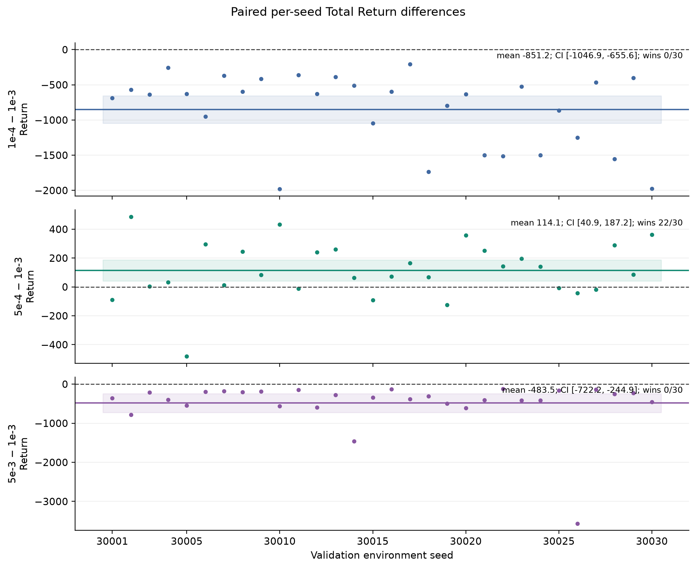
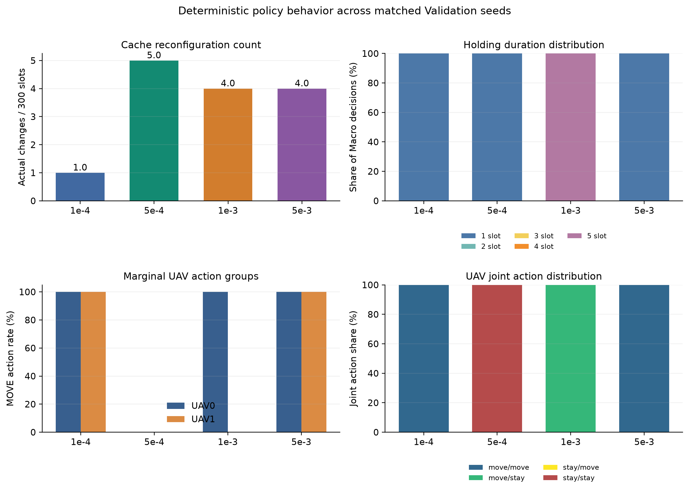

# 四组Macro Actor学习率Validation比较与模型选择

> 统计单位为完整环境realization（30个seed），不是Slot。只分析已完成Validation与训练日志，没有启动新实验。

## 结论摘要

- 四组Validation均为30/30 seed（30001–30030）、repeats=1、deterministic、每环境300 Slot；Checkpoint版本58、policy schema及配置哈希一致。协议核对通过。
- Validation平均Return最高为**5e-4**：3,175.55（SD 183.87；95% CI 3,106.89–3,244.21）；第二为**1e-3**。
- 5e-4−1e-3配对Return差为**114.08**（95% CI 40.91–187.25），5e-4胜22个seed，1e-3胜8个；差值中位数84.47，Q1–Q3为-4.35–250.07。
- PPO更新无持续失稳证据。四组Holding在本次确定性Validation中均集中在边界时长；UAV动作组也高度集中，但MOVE策略多数仍选择不同目标位置。
- 后续Baseline/消融建议使用5e-4 Checkpoint；先检验Holding、Cache更新和双UAV STAY行为，不据此直接修改PPO。

## 1. 数据完整性与可比性

所有seed均有一条repeat summary，repeat_index=0；每seed有600条UAV记录，Holding时长覆盖300 Slot；Cache UPDATE数与实际配置变化数逐seed相符。

| LR | seeds | repeats / 模式 / episode | checkpoint / arch | raw配置SHA-256 | Manifest Macro LR / 训练进度 |
|---|---:|---|---|---|---|
| 1e-4 | 30/30 (30001–30030) | 1 / deterministic / 300 Slot | v58 / arch 31 | fe5d4f7bc57a424911166bcfe921c2ec5a7627b0a6aa759c4993f7f488a3775c | 0.0001 / 300 Episodes, 75 Updates |
| 5e-4 | 30/30 (30001–30030) | 1 / deterministic / 300 Slot | v58 / arch 31 | fe5d4f7bc57a424911166bcfe921c2ec5a7627b0a6aa759c4993f7f488a3775c | 0.0005 / 300 Episodes, 75 Updates |
| 1e-3 | 30/30 (30001–30030) | 1 / deterministic / 300 Slot | v58 / arch 31 | fe5d4f7bc57a424911166bcfe921c2ec5a7627b0a6aa759c4993f7f488a3775c | 0.001 / 300 Episodes, 75 Updates |
| 5e-3 | 30/30 (30001–30030) | 1 / deterministic / 300 Slot | v58 / arch 31 | fe5d4f7bc57a424911166bcfe921c2ec5a7627b0a6aa759c4993f7f488a3775c | 0.005 / 300 Episodes, 75 Updates |

四组raw配置哈希均为fe5d4f7bc57a424911166bcfe921c2ec5a7627b0a6aa759c4993f7f488a3775c；semantic哈希均为64e367ee5c67cbcc86b7741ef0e97fe0de1fecd6b3c07039f77a29c1b17ae45e；policy schema均为adaptive_dual_timescale_proposed_cache_economic_features_fixed_lr_horizon_mask_v2。Pool Checkpoint路径对应各自训练目录latest_checkpoint.pt，Manifest LR匹配且Checkpoint版本58、架构版本31。Pool没有单独保存Checkpoint文件SHA；下表列出当前本地latest文件SHA，属于路径/Manifest/版本核对而非运行时字节签名。

| LR | latest_checkpoint SHA-256 | Pool中的Checkpoint路径 |
|---|---|---|
| 1e-4 | 34e0377c521e03a944ccfc59817a31bca24cee0c5731555aeea10a8fd6e0e9d1 | C:\Users\tangning\Desktop\code\adaptive_cache_mec\runs\formal_cache_economic_v2_lr_1e_minus_4\checkpoints\latest_checkpoint.pt |
| 5e-4 | 4ba388b2dfe87b02a50ae70282e9bf8f4223c0c4d56a9689cb3b49e68aba1318 | /home/9900299/tn/1/runs/formal_cache_economic_v2_lr_5e_minus_4/checkpoints/latest_checkpoint.pt |
| 1e-3 | e6ed46f593f724ff08c89106376ed33aba5f476e6d79e24e5a2613323d379b2e | C:\Users\tangning\Desktop\code\adaptive_cache_mec\runs\formal_cache_economic_v2_lr_1e_minus_3\checkpoints\latest_checkpoint.pt |
| 5e-3 | 152d40a3597ad781bac173664197e5ca3e1361d8be3bf6fbac6a6847eb741a77 | /home/9900299/tn/1/runs/formal_cache_economic_v2_lr_5e_minus_3/checkpoints/latest_checkpoint.pt |

源数据：四个proposed_validation_lr目录中的Pool汇总和每个episode seed逐seedsummary；正式训练目录的run_manifest.json、run_summary.json、episode_metrics.jsonl、update_metrics.jsonl。

## 2. Validation系统性能

Return的区间为跨seed均值的t区间（df=29），SD为seed间样本SD；其他指标同样先按seed汇总。mean_task_delay_s和mean_vehicle_energy_j为每任务均值，单位分别为s/task和J/task；Cache/UAV成本是系统目标成本贡献，不是物理能耗。

| LR | Total Return：均值±SD；95% CI；范围 | Task Utility均值±SD | 时延(s/task) | 车辆能耗(J/task) | Cache目标成本 | UAV移动目标成本 | Cache更新/episode；变化率 | UAV MOVE动作率 |
|---|---|---:|---:|---:|---:|---:|---:|---:|
| 1e-4 | 2,210.2 ± 685.9; [1,954.1, 2,466.3]; 708.5–3,154.0 | 2,212.2 ± 685.9 | 16.45 ± 4.75 | 1.164 ± 0.549 | 0.253 ± 0.037 | 1.716 ± 0.000 | 1.0; 0.33% | 100.00% |
| 5e-4 | 3,175.5 ± 183.9; [3,106.9, 3,244.2]; 2,801.4–3,545.8 | 3,176.5 ± 183.9 | 9.80 ± 1.66 | 0.405 ± 0.103 | 0.955 ± 0.031 | 0.000 ± 0.000 | 5.0; 1.67% | 0.00% |
| 1e-3 | 3,061.5 ± 230.1; [2,975.6, 3,147.4]; 2,685.9–3,465.1 | 3,063.1 ± 230.1 | 10.81 ± 2.10 | 0.461 ± 0.114 | 0.817 ± 0.057 | 0.854 ± 0.004 | 4.0; 1.33% | 49.98% |
| 5e-3 | 2,577.9 ± 672.6; [2,326.8, 2,829.1]; -275.0–3,322.5 | 2,580.3 ± 672.6 | 14.64 ± 4.74 | 0.765 ± 0.535 | 0.666 ± 0.091 | 1.695 ± 0.035 | 4.0; 1.33% | 100.00% |

### 同seed配对Return比较

差值按左侧减右侧定义。95% CI是30个配对差值均值的未调整t区间；不做p值检验或多重比较校正。

| 配对 | 平均差 | 配对差SD | 95% CI | 左侧胜出/30 | 中位数；Q1–Q3；最小–最大 |
|---|---:|---:|---:|---:|---|
| 5e-4 − 1e-3 | 114.08 | 195.95 | [40.91, 187.25] | 22（右侧8, ties 0） | 84.47；-4.35–250.07；-480.35–485.43 |
| 5e-4 − 1e-4 | 965.33 | 611.26 | [737.08, 1,193.58] | 30（右侧0, ties 0） | 779.59；516.63–1,238.69；150.39–2,413.18 |
| 5e-4 − 5e-3 | 597.62 | 652.87 | [353.84, 841.41] | 30（右侧0, ties 0） | 436.94；253.93–645.28；61.53–3,523.23 |
| 1e-3 − 1e-4 | 851.25 | 523.90 | [655.62, 1,046.88] | 30（右侧0, ties 0） | 632.15；474.75–1,199.93；208.05–1,980.21 |
| 1e-3 − 5e-3 | 483.54 | 639.23 | [244.85, 722.24] | 30（右侧0, ties 0） | 352.09；196.06–487.75；119.21–3,565.05 |
| 1e-4 − 1e-3 | -851.25 | 523.90 | [-1,046.88, -655.62] | 0（右侧30, ties 0） | -632.15；-1,199.93–-474.75；-1,980.21–-208.05 |
| 5e-3 − 1e-3 | -483.54 | 639.23 | [-722.24, -244.85] | 0（右侧30, ties 0） | -352.09；-487.75–-196.06；-3,565.05–-119.21 |

5e-4相对1e-3的Task Utility配对差均值113.36（95% CI 40.18–186.54）。5e-4对1e-4和5e-3均在30个seed获胜；对1e-3有22胜8负。差值Q1略低于0，收益优势并非每个环境都一致。配对区间未做多重比较或模型事后选择校正。

## 3. 训练Return收敛趋势

训练Episode使用不同环境实现；分段波动同时含环境差异，不能直接当作参数振荡。

| LR | Ep1–100 | Ep101–200 | Ep201–300 | 最后100均值±总体SD | Ep241–260 / 261–280 / 281–300 | Last Episode |
|---|---:|---:|---:|---:|---|---:|
| 1e-4 | -608.8 | -182.1 | 590.5 | 590.5 ± 1,018.5 | 719.5 / 989.6 / 824.0 | -39.0 |
| 5e-4 | 321.6 | 2,553.9 | 3,085.6 | 3,085.6 ± 236.6 | 3,182.6 / 3,093.7 / 3,127.5 | 3,198.5 |
| 1e-3 | 1,066.1 | 2,670.9 | 2,927.3 | 2,927.3 ± 321.1 | 3,017.2 / 2,869.9 / 2,935.6 | 2,949.0 |
| 5e-3 | 1,457.5 | 2,677.6 | 2,791.2 | 2,791.2 ± 343.7 | 2,921.9 / 2,816.7 / 2,663.1 | 2,519.8 |

- 5e-4后100均值3085.6，末60轮三段均值3182.6、3093.7、3127.5，呈高位平台；1e-3为2927.3，末三段3017.2、2869.9、2935.6，整体相近但有环境间起伏。
- 5e-3后100均值2791.2，末三段2921.9、2816.7、2663.1，存在后段下降信号；1e-4后100均值590.5、总体SD 1018.5，Return波动大。
- 5e-3的训练末100 Return并非四组最高，且Validation均值低于其训练末100约213；这不是“训练均值最高但Validation转差”的模型反转。由于训练/Validation环境不同，该差值不能作为严格泛化差估计。
- Validation减训练最后100均值的简单差：1e-4 +1619.8、5e-4 +90.0、1e-3 +134.1、5e-3 −213.2。没有历史Checkpoint在同一Validation集合连续评估，不能严格证明策略参数已收敛。

## 4. PPO优化稳定性

| LR | Macro KL mean/P95/max/尾20 | Macro Clip Fraction mean/P95/max/尾20 | Micro KL mean/P95/max | Micro Clip Fraction mean/P95/max | Macro early-stop |
|---|---|---|---|---|---:|
| 1e-4 | 0.0004/0.0012/0.0018/0.0004 | 0.0021/0.0138/0.0243/0.0034 | 0.0024/0.0055/0.0067 | 0.0179/0.0565/0.0804 | 0/75 |
| 5e-4 | 0.0022/0.0062/0.0188/0.0015 | 0.0219/0.0651/0.1371/0.0170 | 0.0031/0.0069/0.0140 | 0.0262/0.0558/0.2025 | 0/75 |
| 1e-3 | 0.0061/0.0124/0.0181/0.0072 | 0.0709/0.1785/0.2275/0.0968 | 0.0038/0.0079/0.0096 | 0.0297/0.0904/0.1417 | 0/75 |
| 5e-3 | 0.0168/0.0248/0.4354/0.0068 | 0.0953/0.1718/0.4748/0.0499 | 0.0026/0.0064/0.0099 | 0.0221/0.0688/0.1346 | 2/75 |

- 1e-4、5e-4、1e-3没有Macro/Micro early-stop；Macro KL最大值均低于0.019。
- 5e-3有2/75次Macro early-stop，Macro KL最大0.4354、Macro Clip Fraction最大0.4748，是孤立尖峰；尾20次KL均值0.0068、Clip均值0.0499且无early-stop，Micro KL最大0.0099。现有记录不支持持续更新失稳。
- 优化稳定不等于收益最优或策略自适应。

## 5. Adaptive Holding

Holding分布按Macro决策计数；平均Holding为时长加权均值。Termination规则在src/ppo_simple/policy.py:595-620使用Logit Argmax；高于0.5终止、低于0.5继续，最大Holding上限5 Slot。

| LR | Holding 1/2/3/4/5 Slot占比 | 平均Holding | Termination概率（elapsed: mean [min,max]） |
|---|---|---:|---|
| 1e-4 | 100.0% / 0.0% / 0.0% / 0.0% / 0.0% | 1.00 Slot | e1: 0.558 [0.519,0.579] |
| 5e-4 | 100.0% / 0.0% / 0.0% / 0.0% / 0.0% | 1.00 Slot | e1: 0.751 [0.625,0.829] |
| 1e-3 | 0.0% / 0.0% / 0.0% / 0.0% / 100.0% | 5.00 Slot | e1: 0.294 [0.265,0.345]; e2: 0.295 [0.265,0.351]; e3: 0.295 [0.265,0.369]; e4: 0.296 [0.264,0.432] |
| 5e-3 | 100.0% / 0.0% / 0.0% / 0.0% / 0.0% | 1.00 Slot | e1: 0.794 [0.765,0.799] |

- 1e-4、5e-4、5e-3均每次选择TERMINATE，固定1 Slot；概率均值分别约0.558、0.751、0.794，观测概率均在0.5以上。
- 1e-3的elapsed=1–4概率均值约0.294–0.296，观测概率均低于0.5，因此继续到5 Slot上限。四组均未产生2–4 Slot中间时长。
- 每个elapsed下Termination概率在不同决策观测间有变化，但始终在Argmax阈值同侧。逐次概率未与完整状态向量导出，无法确定概率变化由哪些状态特征驱动或是否有益。

## 6. Cache策略与实际重配置

KEEP/UPDATE是Cache动作组；cache_change_rate以300个物理Slot为分母，actual_cache_update_rate以Macro决策为分母。KEEP不表示Cache未命中。

| LR | KEEP/UPDATE决策数 | KEEP比例 | 实际配置更新/episode | 实际变化率/Slot | 更新Slot（0-based；seed数） | mean p(KEEP) |
|---|---:|---:|---:|---:|---|---:|
| 1e-4 | 8,970/30 | 99.67% | 1.0 | 0.33% | [0] (30/30) | 0.640 |
| 5e-4 | 8,850/150 | 98.33% | 5.0 | 1.67% | [0, 1, 2, 3, 4] (30/30) | 0.718 |
| 1e-3 | 1,680/120 | 93.33% | 4.0 | 1.33% | [0, 5, 10, 15] (30/30) | 0.896 |
| 5e-3 | 8,880/120 | 98.67% | 4.0 | 1.33% | [0, 1, 2, 3] (27/30); [0, 1, 2, 101] (1/30); [0, 1, 2, 34] (1/30); [0, 1, 2, 38] (1/30) | 0.886 |

- 1e-4每seed只在Slot0更新一次；5e-4在Slot0–4各更新一次；1e-3在Slot0、5、10、15更新后长期KEEP；5e-3有27/30个seed在Slot0–3更新，另外3个seed把第4次更新放到Slot34、38、101，其余时间KEEP。
- 逐seed UPDATE数均与真实配置变更数一致。p(KEEP)跨决策有变化，但实际更新slot高度重复；日志不足以把服务流行度、新旧Cache内容与每个决策完整对应，不能判断更新是否合理，也不能从KEEP率推出命中率。5e-4缓存目标成本高于1e-3，但这只是共同结果观察，不是更新行为的因果收益。

## 7. UAV联合动作和目标位置

UAV日志记录每Slot动作组、候选位置和来源；src/ppo_simple/policy.py:145-157, 895-910先做组概率Argmax，再在MOVE组中选位置。MOVE动作率不等同于移动距离或能耗。

| LR | UAV0 MOVE率/p(MOVE) | UAV1 MOVE率/p(MOVE) | 联合MM/M-S/S-M/SS | 每seed不同MOVE目标平均数（UAV0/UAV1） |
|---|---|---|---|---|
| 1e-4 | 100.00%/0.772 | 100.00%/0.620 | 100.00% / 0.00% / 0.00% / 0.00% | 248.3 (212–275) / 241.2 (167–282) |
| 5e-4 | 0.00%/0.135 | 0.00%/0.133 | 0.00% / 0.00% / 0.00% / 100.00% | 0.0 (0–0) / 0.0 (0–0) |
| 1e-3 | 99.96%/0.568 | 0.00%/0.406 | 0.00% / 99.96% / 0.00% / 0.04% | 299.7 (298–300) / 0.0 (0–0) |
| 5e-3 | 100.00%/0.638 | 100.00%/0.550 | 100.00% / 0.00% / 0.00% / 0.00% | 223.7 (60–289) / 187.7 (144–297) |

- **1e-4：** 100% MOVE/MOVE；两机目标位置相邻Slot均改变。每seed平均不同MOVE目标248.3（UAV0）和241.2（UAV1），来源均为geometry_exploration：动作组固定，位置随Slot/环境变化。
- **5e-4：** 100% STAY/STAY，p(MOVE)均值0.135/0.133，无MOVE目标且STAY位置不变：动作组与目标位置都缺乏变化的证据最明显，但不说明STAY无效。
- **1e-3：** UAV0 MOVE 8,996/9,000次，p(MOVE)=0.568，位置几乎每Slot改变、每seed平均299.7个目标，来源demand_centroid或geometry_exploration；UAV1全程STAY，p(STAY)=0.594，目标位置固定。联合MOVE/STAY 99.96%、STAY/STAY 0.04%。
- **5e-3：** 100% MOVE/MOVE，p(MOVE)=0.638/0.550；目标位置每Slot改变，每seed平均不同目标223.7/187.7，来源geometry_exploration：动作组固定但MOVE位置变化。
- 四组动作组选择都几乎不随Validation seed改变；MOVE时目标确实变化，但缺少状态对照和反事实证据，不能宣称这种变化带来策略收益。

## 8. 确定性Argmax的解释

- Holding用Termination Logit Argmax；概率略高于0.5就会每次终止，低于0.5就会每次继续。
- Cache按KEEP/UPDATE组概率质量比较，UAV按STAY/MOVE组概率质量比较，再在MOVE内选候选位置。即使动作组概率只有0.51，deterministic策略也会连续选择该组。1e-3 UAV0 p(MOVE)=0.568、UAV1 p(STAY)=0.594，5e-3 UAV1 p(MOVE)=0.550，均可产生持续单一组动作。
- 该机制解释了确定性动作组集中，不代表代码实现错误，也不证明动作组性能优。必要代码路径见src/ppo_simple/policy.py:145-157, 595-620, 895-910和src/ppo_simple/rollout.py:801-814, 995-1008。

## 9. 综合判断与模型选择

| 项目 | 结论 | 证据限制 |
|---|---|---|
| Validation Return最优 | **5e-4** | 均值3175.55；第二1e-3，然后5e-3、1e-4。
| 训练后期收益 | **5e-4/1e-3处于高位平台；1e-4波动大；5e-3末段下降信号** | Episode环境不同，无同环境历史Checkpoint曲线，不能证明严格收敛。
| PPO更新 | **无持续失稳** | 5e-3存在两次早期尖峰，尾段正常。
| Holding适应性 | **四组在当前确定性Validation均固定边界时长** | 不代表随机策略或其他状态下也固定；概率变化仍处于阈值同侧。
| Cache适应性 | **多为KEEP，重配置偏前期** | 缺少需求与配置的逐步关联，无法评估更新合理性。
| UAV适应性 | **动作组集中，位置变化因机体而异** | 5e-4双STAY、1e-3 UAV1固定STAY；MOVE组目标变化不证明效益。
| 是否立即改PPO | **不建议仅据当前结果修改学习机制** | 先做有控制的同seed消融。

### 正式选择

BEST_VALIDATION_MACRO_LR = 5e-4
BEST_MODEL_CHECKPOINT = C:\Users\tangning\Desktop\code\adaptive_cache_mec\runs\formal_cache_economic_v2_lr_5e_minus_4\checkpoints\latest_checkpoint.pt
BEST_VALIDATION_RETURN = 3175.548002
SECOND_BEST_MACRO_LR = 1e-3
PAIRED_COMPARISON_5E4_VS_1E3 = mean_diff +114.08; 95% CI [40.91, 187.25]; wins 22/30
RECOMMENDED_MODEL_FOR_ABLATION = 5e-4 latest_checkpoint.pt

Cache/UAV联合控制没有脱离收益目标的唯一“最佳”策略可从这些结果判定：5e-4的UAV移动目标成本为0但Cache目标成本最高；1e-3有较低Cache成本、较高UAV移动成本及略低Return。现有Validation不含控制组件反事实，因此推荐5e-4是按Return的模型选择，不是宣称其Cache/UAV控制机制最优。

### 下一阶段消融建议

1. 用5e-4对照学习Holding与固定1/5 Slot。
2. 对照学习Cache、固定Cache或周期更新，关联实际配置变化和服务需求。
3. 对照双UAV动态部署与固定部署，重点检验5e-4当前双STAY行为。

各项用同seed配对并逐一改动组件。本次没有执行消融。

## 10. 指标定义及来源

- Validation：四个proposed_validation_lr目录中的pool汇总和30个逐seedsummary。
- Training：formal_cache_economic_v2_lr目录的300行episode_metrics、75行update_metrics及Manifest/summary。
- src/ppo_simple/evaluator.py:242-285根据每Slot action统计双UAV联合动作及MOVE率；src/ppo_simple/rollout.py:1297-1315记录Cache实际更新和UAV动作组；rollout.py:1366-1375记录时延、能耗和系统成本。配置注释说明Cache/UAV成本是目标设计成本，不是物理能耗。
