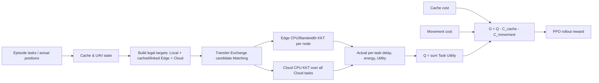

# 阶段3A：有限 Cloud CPU 池与资源感知卸载实现方案

## 范围与结论

本报告只依据当前静态源码、配置结构及阶段2B/2C报告设计后续实现；没有改源码、TOML、Checkpoint，也没有运行测试、仿真、Validation或PPO。阶段3拟采用同Slot共享Cloud CPU池，实验锚点 (F_C^{total}=60\,GHz)，并在候选集中同时保留Cloud与合法Edge节点，由实际资源分配后的Task Utility决定执行节点。该60 GHz值是实验设计参数，不是物理标定结论。

**实现路径明确，但必须把 Cloud 池耦合纳入 Matching 的完整评价、增量作用域、缓存和剪枝上界。** 仅将Cloud放进候选，或仅改 `cloud_execution()` 的CPU参数，不足以得到正确的有限池模型。Reward、PPO网络结构、动作空间和Edge KKT不需要改变。

## 1. 当前代码结构

| 模块 / 函数 | 现有行为 | 阶段3设计影响 |
|---|---|---|
| `src/decision/task_allocation.py::build_feasible_targets()` | Local命中时先加入Local；Edge候选要求服务缓存，并在有物理上下文时检查位置、范围、正CPU/带宽和正链路速率。`LEGACY_EDGE_GATE` 有Edge时只保留Edge，无Edge才加Cloud；`RESOURCE_AWARE_FALLBACK` 则保留所有合法Edge并始终加Cloud。 | 新配置必须将候选模式设为资源感知；现有候选构造已基本符合目标。可行候选不等同于资源KKT可行或高效用。 |
| `optimize_task_matching()` | 输入任务、位置、缓存、项目配置和节点配置；建立候选集，以每个任务的首个候选作为初始Matching，再运行Transfer-Exchange并可选复检稳定性。默认候选模式为旧门控。 | 正式调用须把新模式传进来。资源感知模式当前Edge顺序在Cloud之前，可能让初始解把任务集中到Edge；建议用Local（若可用），否则Cloud作为资源可行起点，再由Matching转移到更优Edge。 |
| `allocate_resources_kkt()` | 按每个SV/RSU/UAV的任务集分别分配CPU份额 (w) 与带宽份额 (b)，满足各节点份额和不超过1；Cloud明确不进入该函数的KKT资源图。 | Edge KKT维持原状；新增独立Cloud CPU池分配器，在每个完整候选Matching上解一次Cloud CPU分配。 |
| `evaluate_matching_with_kkt()` / `evaluate_matching_candidate()` | Edge任务按节点全任务集KKT；Local单独计算；Cloud逐任务调用 `system_model.cloud_execution()`，均传入配置里的固定5 GHz及200 Mbps。输出总Task Utility、执行位置、时延、能耗和Edge资源分配。 | 完整评价要按候选Matching里的全部Cloud任务计算池内分配，再用各任务实际 (f_{v,C}) 计算Cloud时延和效用。 |
| `_candidate_impact_scope()` / `evaluate_matching_candidate_incremental()` | 仅把当前/候选Edge节点及其全部共享任务纳入受影响范围；Cloud被注释为每任务固定资源，其他Cloud任务不受影响。 | Cloud成员发生增删时，必须把当前及候选Cloud池中的全部任务加入影响集，并重算候选池；否则Task Utility差值、资源分配和Matching接受判断都不正确。 |
| `_strict_ideal_resource_upper_delta()` / `_ideal_task_utility()` | 剪枝上界对Cloud使用现有每任务5 GHz模型；当前只需计算Edge节点耦合。 | 在有限池下，旧Cloud“理想”值可能低估一个任务从总池取得的CPU，成为不安全剪枝。最初可对任何改变Cloud成员的操作禁用严格上界剪枝；证明新的可采纳上界后再启用。 |
| `_better_candidate()` | 资源感知模式下，对效用容差内的候选按被操作任务 `new_targets` 中Cloud数量少者优先，而非按完整最终Matching中的Cloud数量。Matching仍只接受 `delta_J > tolerance` 的操作；停止与历史断言也要求严格Task Utility增加。 | 需要把平局定义为完整Matching的二级顺序，并处理相对当前Matching的零增益Edge转换，否则平局Edge不会真正落地。 |
| `src/decision/slot_environment.py::execute_slot()` | 收到最终Cache/UAV状态和真实任务/位置；调用 `optimize_task_matching()` 时没有传 `cloud_fallback_mode`，因此正式环境仍走默认旧门控；之后计算 (G=Q-C_{cache}-C_{movement})。 | 从已解析配置将候选模式传入Matching。Cloud CPU模式和容量可通过扩展的 `cache_config` 传递，无需穿过PPO rollout逐层添加物理参数。 |
| `src/common/system_model.py::cloud_execution()` | 函数参数已接收单任务 `cloud_cpu_cycles_per_s`，公式为 (\psi_cD/R_c+L/F_c)，车辆能耗为 (pD/R_c)。 | 数学接口可直接传实际分配的 (f_{v,C})，无须改Reward或时延公式；可更新文档字符串以澄清有限池模式下传入的是分配值。 |

当前正式环境没有调用 `RESOURCE_AWARE_FALLBACK`。该模式目前存在于Matching API，但 `execute_slot()` 未从配置读取/传递它。阶段3必须完成配置到实际环境调用的接线，而不仅是沿用阶段2A诊断入口。

## 2. Cloud CPU 数据结构

建议将**合同配置**与**一次Matching候选的分配结果**分开，避免将资源分配作为跨Slot可变环境状态保存。

```text
CloudResourceContract (immutable, run/环境级)
  mode: legacy_unlimited | finite_pool
  pool_capacity_cycles_per_s: 60e9   # finite_pool 必需
  per_task_cpu_cycles_per_s: 5e9     # 仅 legacy_unlimited 使用
  uplink_rate_bps_per_task: 200e6    # 两种CPU合同均保持独立等效链路
  delay_factor: 11

CloudCPUAllocationResult (immutable, 单个Matching候选级)
  feasible
  allocations_cycles_per_s: task_id -> f_v,C
  capacity_cycles_per_s
  used_cycles_per_s
  remaining_cycles_per_s
  kkt_diagnostics
```

实现上可将合同字段放入现有 `CacheOptimizationConfig`，减少 `execute_slot()` 到Matching的大量参数传递；分配结果由 `task_allocation.py` 的Cloud KKT返回，嵌入 `KKTMatchingEvaluation`，最终由 `TransferExchangeMatchingResult` 暴露。不要把Cloud的绝对CPU（cycle/s）塞进当前 `cpu_allocations`：该字段目前记录Edge节点的无量纲CPU份额，混用单位会造成误读。车辆上传链路保持独立，不创建共享Cloud带宽状态。

Cloud没有跨Slot任务队列，所以每个候选Matching都从零计算本Slot池内任务分配；`allocated_cpu` 和 `remaining_cpu` 是这个候选的诊断输出，候选求值后即丢弃。KKT缓存是单次Matching调用内的纯性能缓存，不是资源状态。

## 3. 新Matching与Candidate规则

1. 任务候选仍由服务缓存、物理链路和本地缓存生成。资源感知配置下为 `Local（若缓存可用） + 所有合法Edge + Cloud`。Cloud始终是候选，不因Edge缓存存在而删除。
2. 候选阶段不按假设的独占Edge时延或静态Cloud时延提前选定执行节点。所有需要比较的候选Matching均用该Matching的完整Edge节点任务集和Cloud任务集运行资源分配，再计算每个任务的原始Task Utility。
3. Utility严格较高的Matching获胜。只在**完整总Task Utility差**位于既有objective tolerance内时，选择完整最终Matching中Cloud任务数较少者；仍相同则用确定性operation key。不得给Edge加奖励或给Cloud加惩罚。
4. 当前的首候选初始化在资源感知模式下通常把任务先放到Edge，然后才考虑Cloud；有限Edge任务集可能触发KKT最小份额限制。建议对新模式使用资源可行的起点：有Local候选就先用Local，否则先用Cloud；Transfer-Exchange随后按实际效用迁移。该起点只影响搜索入口，不代表严格Edge优先或最终选择。
5. 对资源受限的Edge方案，若KKT失败，则将该候选标为不可行并由Transfer-Exchange比较其他Edge/Cloud候选。Cloud本身也必须满足正容量及Cloud最小份额约束，不能假定池总是可行。

**平局处理是实现风险点。** `_better_candidate()` 的当前 tie-break 只看被操作任务的新目标数；并且 `best is None or delta_J <= tolerance` 会停止搜索，故相对当前Cloud Matching的等效用Edge转换不会应用。新规则需按“首要目标 (Q)、次要目标 (-N_{Cloud})、确定性操作顺序”处理：Task Utility超过容差时始终胜过Cloud数偏好；在容差内减少Cloud数才允许作为不降低首要目标的tie move。稳定性检查也必须检查是否还有平局的Edge降Cloud操作。为防容差累计造成 (Q) 逐步下滑，不能无边界地逐步接受多个容差内的负增益；应相对当前阶段的最高已确认 (Q) 保持总容差预算，或仅接受非负精确增益的tie move。Tie move不能被记为Reward增长。

## 4. Cloud KKT与共享资源耦合

在有限模式下，对当前候选Cloud任务集合 (\mathcal V_C) 分配 (f_{v,C}>0)：

\[
\sum_{v\in\mathcal V_C} f_{v,C}\le F_C^{total},\qquad F_C^{total}=60\times10^9\;\mathrm{cycle/s}.
\]

Cloud上传速率及车辆传输能耗不依赖 (f_{v,C})，因此给定Cloud任务集合时，CPU KKT的可分离目标是最小化加权计算时延：

\[
\min_{f}\sum_{v\in\mathcal V_C}\frac{\omega_T L_v}{T_{ref}f_{v,C}}.
\]

可令 (x_v=f_{v,C}/F_C^{total})，复用现有 `solve_kkt_fraction_allocation()`：系数为 (c_v=\omega_TL_v/(T_{ref}F_C^{total}))，约束 (\sum x_v\le1) 和 (\epsilon_C\le x_v\le1)，最后换算为 (f_v=x_vF_C^{total})。等价最优解对正系数任务满足 (x_v=\mathrm{clip}(\sqrt{c_v/\lambda},\epsilon_C,1))。该池只影响Cloud计算时延；Cloud通信时延仍为 (\psi_cD/R_c)，能耗仍为 (pD/R_c)。

约束应放在 `task_allocation.py` 的**Matching资源评估/KKT层**，而非PPO或环境状态更新层。保留 `allocate_resources_kkt()` 管理SV/RSU/UAV的分节点CPU和带宽；新增 `allocate_cloud_cpu_kkt()`（或同等独立 helper）处理同Slot Cloud CPU池。`evaluate_matching_with_kkt()` 同时组合这两类分配结果，`system_model.cloud_execution()` 仅消费分配好的CPU值。

### 增量Matching的必要调整

- 若一个Transfer/Exchange使任一任务进出Cloud，资源耦合影响**当前Cloud任务集与候选Cloud任务集的并集**。需要在 `_candidate_impact_scope()` 返回的影响范围中标出Cloud池受影响，并让 `evaluate_matching_candidate_incremental()` 重算所有候选Cloud任务；Edge节点影响范围仍按现有方式计算。
- 重新评价候选时清除旧Cloud池的分配/资源总量，再计算新Cloud池，最后更新所有受影响任务的延迟、Utility与分配映射。Local/Edge任务不应误计入Cloud池。
- 只有Cloud任务成员集合未变时，才可复用Cloud池分配；若候选中Cloud成员变化，就不能只重算被操作任务。`KKTResourceAllocationCache` 当前以节点ID、任务ID和节点位置为键；建议单独建Cloud pool cache，键至少包括Cloud任务集合、输入数据、CPU cycles、容量、合同模式和求解参数。容量虽然在一次Matching内固定，加入键仍可防止未来扩大缓存生命周期后错误复用。
- `KKTMatchingEvaluation` 和结果检查要暴露/核对 `sum(f_v,C) <= F_C_total`、每任务分配下界、有限数值及剩余容量。现有 `_resource_constraints_ok()` 明确跳过 `CLOUD`，必须新增有限池检查。
- 在新池剪枝上界经过证明前，对Cloud成员变化的候选关闭 `_strict_ideal_resource_upper_delta()` 的Cloud剪枝，保留完整精确评价。因为旧 `_ideal_task_utility()` 采用5 GHz/task，不保证是60 GHz池分配后的上界。恢复剪枝前可用“每个候选Cloud任务各自独占整个 (F_C^{total})”构造松弛上界，并证明其Task Utility确实不低于任何合法共享分配；这种上界可能较松。
- Transfer-Exchange已按候选操作评价完整Task Utility，Cloud池加入后候选数和每个Cloud变更的受影响任务数都会增加。KKT/节点缓存可复用相同完整任务集；不得以只重算操作任务的旧增量假设换取速度。

Edge CPU/Bandwidth KKT公式不变。Cloud CPU池和各Edge节点池是分开的约束，不存在Cloud CPU与Edge CPU相互转移。新增Cloud solver在每个Matching候选上最多是一组随Cloud任务数变化的一维单调二分；运行时增加主要来自候选数量扩大、Cloud成员变化造成整池任务重评以及缓存命中率降低，而不是引入非凸KKT结构。

## 5. Reward、数据流与需要接线的参数



实际数据流是：`scenario_generator.sample_tasks()` 及逐Slot数据提供任务到达、服务ID、输入量和CPU cycles；PPO根据已有Cache/UAV及预测特征给出动作；`slot_environment.execute_configured_slot()` 将动作形成最终Cache/UAV配置；`execute_slot()` 用实际车辆位置和最终UAV位置建服务节点位置，调用 `optimize_task_matching()`；Matching构造可行目标，重复评价Transfer/Exchange候选；每个候选调用Edge KKT和Cloud CPU池KKT；最终任务结果形成 (Q=\sum_vQ_v)，再由现有逻辑计算 (G=Q-C_{cache}-C_{movement})，返回 `SlotExecutionResult`，供Rollout累计Reward。

| 函数/对象 | 参数或输出调整建议 |
|---|---|
| `cache_config_from_project()`、`CacheOptimizationConfig` | 增加Cloud CPU模式、有限池容量和候选模式（或独立Matching配置）；在这里校验并提供只读合同。 |
| `slot_environment.execute_slot()` | 将配置的候选模式传给已有 `optimize_task_matching(..., cloud_fallback_mode=...)`。无需在PPO rollout或每个调用者另传F_C。 |
| `allocate_cloud_cpu_kkt()` | 新增输入Cloud任务集合、CPU池容量、KKT下界/精度；输出有单位的分配、总量、残量及诊断。 |
| `evaluate_matching_with_kkt()` / `evaluate_matching_candidate()` | 消费有限池输出；把每个任务实际 (f_{v,C}) 传入现有 `cloud_execution()` CPU参数。 |
| `_candidate_impact_scope()` / `evaluate_matching_candidate_incremental()` | 加Cloud pool受影响标志/Cloud任务影响集合；Cloud变化时重评旧/新整池。 |
| `TransferExchangeMatchingResult` / `SlotExecutionResult` | 若训练日志与诊断需要复核资源合同，另设Cloud CPU分配字段，明确单位为cycle/s，避免复用Edge无量纲份额字段。 |

`system_model.task_utility()` 计算 (Q_v=\omega_T(1-T_v/T_{ref})+\omega_E(1-E_v/E_{ref}))。有限池只会通过Cloud CPU分配改变Cloud任务的 (T_v) 和Utility；Reward仍是原公式，Cache cost与Movement cost仍沿原路径计算。因此 **Reward不修改**。Cloud CPU本身不改变车辆上传能耗公式；不要将 (\psi_c) 乘进车辆能耗。

## 6. 配置、旧实验与训练兼容

建议把两个独立决策分别配置，避免把CPU合同和卸载候选规则混为一谈：

```toml
[nodes.cloud]
cloud_resource_mode = "legacy_unlimited" # 或 "finite_pool"
cpu_pool_capacity_cycles_per_s = 60.0e9   # finite_pool 时必填，实验锚点

[algorithm.matching]
cloud_fallback_mode = "LEGACY_EDGE_GATE"  # 或 "RESOURCE_AWARE_FALLBACK"
```

- `cloud_resource_mode` 控制Cloud CPU合同；`cloud_fallback_mode` 控制候选集。阶段3配置用 `finite_pool` + `RESOURCE_AWARE_FALLBACK`；legacy默认是 `legacy_unlimited` + `LEGACY_EDGE_GATE`。保留两项独立切换，可做消融和旧行为复现。
- 不重用当前 `nodes.cloud.total_cpu_cycles_per_s` 表示新池。它在当前 `CacheOptimizationConfig` 与 `project_config.validate_config()` 中是旧每任务CPU字段的相等兼容别名；有限池需要独立清楚的 `cpu_pool_capacity_cycles_per_s`。现有 `nodes.cloud.resource_sharing` 在当前校验中必须为false，不能简单改true作为新合同。应让新模式字段决定CPU语义，并将旧布尔字段限制为legacy兼容/弃用字段；Cloud uplink仍不共享。
- `project_config.validate_config()`、`FORMAL_SYSTEM_PARAMETER_KEYS`、`CacheOptimizationConfig.validate()` 需按模式校验：legacy要求现有5 GHz/task及旧别名一致；finite要求总容量有限且正数、KKT下界可行，不再把旧5 GHz字段误作总容量。60 GHz在参数状态中应明确记作 `EXPERIMENT_DESIGN`（或在采用 `PROVISIONAL_IMPLEMENTATION` 时显式使用允许暂定参数的流程），不得标为 `CONFIRMED_DATA`。
- **旧配置兼容**：旧TOML缺少新字段时，解析层不改写原始字典，读取时将缺失mode解释为legacy，并令候选模式默认旧门控。不要把显式默认字段注入旧配置后再计算语义哈希。`semantic_config_hash()`对完整配置内容求哈希；旧run的冻结 `runs/<run>/run_config.toml` 不修改、不覆盖。
- **新实验配置**：新增版本化配置，例如 `configs/proposed/system_config_stage3_cloud_finite_60ghz.toml`，保留原 `configs/proposed/system_config.toml` 与 `scripts/training/run_proposed_formal.py` 不变。Stage3训练使用新配置、新Run目录与新的 `run_config.toml` 快照；现有trainer已保存原始/语义配置哈希并拒绝同run目录配置不一致。旧Checkpoint不能作为同一环境的正式续训或旧结果；如作为初始化权重，需单独标记为新实验设计。
- **Episode数据**：任务生成器的 `generation_config_fingerprint`只包含仿真、任务、预测和Scenario生成参数，不包含Cloud资源合同；任务CSV、轨迹、预测和Cache初始数据本身不因Cloud CPU变化而需要重生成。Stage3训练可复用相同外生Episode输入，但训练/Matching结果必须另存。注意 `validate_episode_provenance()`默认还核对生成时Git身份；源码修改后用生成器严格复核旧Episode可能因source identity不一致而失败。这是来源校验问题，不代表Cloud容量改变了场景内容；不要覆盖旧Episode池，必要时使用新池或明确的来源校验策略。
- PPO配置观察只包含Cache、UAV位置、预测车辆位置/服务流行度及时间特征；静态 (F_C^{total}) 是配置合同，不需要新观察特征、PPO网络层或动作空间。Reward/状态转移语义改变，所以新模型需要新的训练运行与Checkpoint。当前LR汇总器对既有正式报告还要求公共 `system_config.toml` 路径；Stage3结果应单独报告或另行设计兼容汇总，不应混入旧LR对照。

## 7. 修改文件范围

| Stage3B文件 | 计划修改 | 必要性 |
|---|---|---|
| `src/decision/task_allocation.py` | Cloud CPU KKT与分配结果；完整评估、增量影响范围和资源检查；Cloud任务集缓存键；安全剪枝；资源感知候选接线/起点；Utility容差内Edge平局和收敛规则。 | 必需，核心算法改动。 |
| `src/decision/cache_configuration.py` | `CacheOptimizationConfig` 增加合同字段；解析与模式条件校验。 | 必需，集中读取系统资源合同。 |
| `src/common/project_config.py` | 新键默认/类型/单位/枚举/模式条件校验；把Cloud池容量纳入正式系统参数状态门。 | 必需，当前代码明确禁止共享Cloud CPU且强制旧字段相等。 |
| `src/decision/slot_environment.py` | 将配置的Cloud候选模式传至Matching；如需导出Cloud分配，扩展Slot结果结构。Reward段保持不动。 | 必需，现有正式路径没有传递阶段2A候选模式。 |
| `src/common/system_model.py` | 公式不改；可仅更新 `cloud_execution()` 注释，说明CPU入参是本任务实际分配的cycle/s。 | 可选文档性改动。 |
| `configs/proposed/system_config_stage3_cloud_finite_60ghz.toml` | 新建独立Stage3配置，标明60 GHz实验锚点、finite_pool及资源感知候选；现有默认/冻结配置保持旧语义。 | 新增配置，避免重解释旧训练。 |
| 诊断/日志序列化模块（按所需结果选择） | 保存Cloud CPU容量、每任务分配、池用量/残量及求解诊断。 | 若需要正式逐Slot复核，建议纳入；不是Reward或PPO模型必需项。 |

当前未修改上述任一文件。本报告没有要求修改PPO主体、训练器核心或已有正式实验入口；如需单独Stage3启动脚本，应新增独立入口而非改写旧入口。

## 8. 风险与Stage3B最小验证

| 风险 | 成因与控制 |
|---|---|
| Cloud KKT数值或可行性 | 现有一维二分可解凸目标，但 (N_C\epsilon_C>1)、容量非正、NaN/Inf或停止精度不足会使分配失败。按配置模式校验正容量/份额边界，并在结果中检查资源残差和有限性。 |
| Matching运行时间上升 | Cloud候选增加每个任务的目标数；任何Cloud成员变化会改变池内全部Cloud任务分配。先保持正确的全池重算，再根据测量优化缓存/上界；不可恢复旧的仅局部任务作用域。 |
| Matching局部稳定与Tie循环 | Transfer-Exchange仍是局部搜索。Cloud池改变效用耦合；Edge平局允许等效用移动后，原严格Q单调断言需区分主目标与二级规则，且需保证零增益操作不会循环。 |
| 错误剪枝/缓存复用 | 5 GHz/task ideal upper bound对有限池不安全；Cloud分配依赖完整任务集。受影响候选先全算，缓存键包含完整池合同和任务负载。 |
| 搜索初值不可行 | 资源感知候选顺序Edge在Cloud前；“每个任务有合法目标”不保证所有任务集中到同一Edge后的KKT可行。Local/Cloud资源可行起点和显式KKT校验避免断言失败。 |
| Cloud物理语义过度解释 | 60 GHz是实验锚点，独立Cloud uplink与 (\psi_c=11) 仍是现有合同，不意味着这些数值已经标定。结果表述要保留实验设计标签。 |

Stage3B建议只做直接覆盖上述变更的Focused tests，不在本阶段运行：legacy配置缺新键时能保持5 GHz/task与旧门控；有限池容量和每任务分配正确、总量不超60 GHz；Cloud任务增删时完整与增量评价的Task Utility/分配一致；空Cloud池、边界容量及最小份额不可行能正确处理；超过Utility tolerance的Cloud优势不会被Edge偏好覆盖，容差内等效方案则选Cloud更少者且算法终止；Reward恒等式仍为 (G=Q-C_{cache}-C_{movement})。然后才用小型静态配对输入验证Stage3实现，正式训练/Validation应另行授权。

## 9. 实施顺序

1. 先定字段名、旧键迁移规则及实验状态标签；新增版本化Stage3 TOML，不动现有配置和run快照。
2. 实现Cloud pool CPU KKT和显式分配结果；接入完整Matching评估，确认Reward消费的仍是原Task Utility。
3. 修正Cloud影响作用域、完整/增量一致性及缓存键；Cloud变化候选在上界证明前不剪枝。
4. 接通资源感知候选配置；建立可行起点并实现真正的Edge平局优先、稳定终止规则。
5. 补充Cloud CPU分配/总量诊断字段及Focused tests；通过后再建立新Run目录，旧Checkpoint/实验保持隔离。

```ini
STAGE3_IMPLEMENTATION_READY = YES_FOR_SEPARATE_EXPERIMENTAL_MODEL (60 GHz is an explicit uncalibrated design anchor; no code was changed in Stage3A)
REQUIRED_SOURCE_FILES = [src/decision/task_allocation.py, src/decision/cache_configuration.py, src/common/project_config.py, src/decision/slot_environment.py]
REQUIRED_CONFIG_CHANGES = [new versioned configs/proposed/system_config_stage3_cloud_finite_60ghz.toml with cloud_resource_mode=finite_pool, cpu_pool_capacity_cycles_per_s=60e9, cloud_fallback_mode=RESOURCE_AWARE_FALLBACK; keep canonical legacy config and existing run_config snapshots unchanged]
PPO_STRUCTURE_CHANGE_REQUIRED = NO (static capacity adds no observation/action dimension; new environment semantics require a new training run/checkpoint)
REWARD_CHANGE_REQUIRED = NO (retain Q - C_cache - C_movement and existing Task Utility)
ESTIMATED_IMPLEMENTATION_SCOPE = MEDIUM_TO_LARGE (4 core source modules, one versioned config, Cloud pool KKT plus exact incremental/search/tie changes, focused parity/compatibility tests)
```
